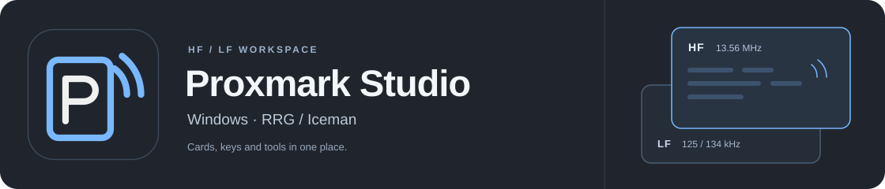
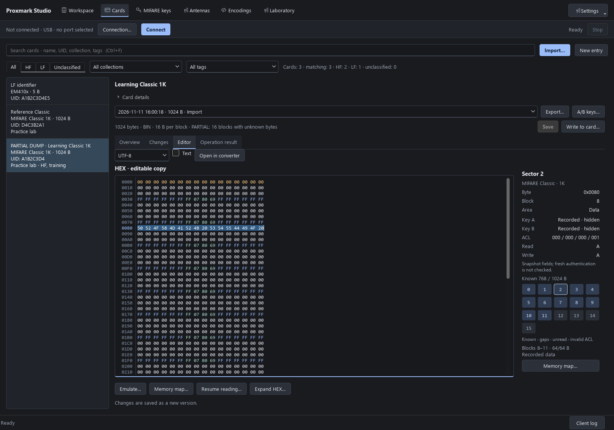

# Proxmark Studio

[Русский](README.ru.md) · [User guide](docs/USER_GUIDE_EN.md) · [Releases](https://github.com/Semy0nBu/proxmark-studio/releases)

A desktop workspace for Proxmark3: identify a card, save its data, inspect a
dump, and prepare a write. Keep cards, keys, and dump revisions in a local
library, with RRG/Iceman tools available from the same interface.

**English / Russian · Windows 10 (1903+) / 11 · x64**

## Download

Current release: **0.3.0-preview.1**. The matching Proxmark client and runtime
are included. You do not need to install Python or a separate client.

| Package | Getting started |
|---|---|
| **[Windows installer](https://github.com/Semy0nBu/proxmark-studio/releases/download/v0.3.0-preview.1/ProxmarkStudio-0.3.0-preview.1-Setup-x64.exe)** | Installs for the current user, with desktop and Start Menu shortcuts selected by default. |
| [Portable ZIP](https://github.com/Semy0nBu/proxmark-studio/releases/download/v0.3.0-preview.1/ProxmarkStudio-0.3.0-preview.1-windows-x64.zip) | Extract the entire archive and open `ProxmarkStudio.exe`. |

Installation works offline and does not require administrator rights. Connect
your Proxmark over USB, select **USB → COM port → Connect**, and place a card on
the appropriate HF or LF antenna. The [user guide](docs/USER_GUIDE_EN.md) covers
the next steps.

## Interface



*The screenshot uses demo data. Choose the interface language in the sidebar.*

## Features

| Area | What you can do |
|---|---|
| **HF / LF reading** | Detect and identify cards, work in either band, or use automatic intake with duplicate suppression. |
| **Card library** | Add names and notes, search, keep revision history, save complete or partial dumps, and resume Classic reads. |
| **MIFARE keys** | Track candidate and verified values, sources, and dates; import dictionaries and Flipper Zero files, or fetch supported data over USB. |
| **Data editor** | Edit HEX, inspect encodings and printable strings, and view Classic memory and access conditions. |
| **Writing** | Use the one-card HF wizard for target checks, backup, plan review, and readback; access dedicated LF tools. |
| **Laboratory** | Work with Classic / Magic, NDEF, emulation, traces, waveforms / FFT, SPIFFS, and HF/LF antenna measurements with baselines. |

Partial dumps retain a **known-byte map**. Gaps can be filled with zeros while
remaining marked as unread. The write wizard presents a plan before changing
the card and checks written data through readback. An EM410x library record
stores an identifier rather than an image of the chip's entire memory.

## Connections and hardware

The project's hardware test setup is a **Proxmark3 RDV4.01 with Blue Shark**.

| Connection | What it needs |
|---|---|
| **USB** | A cable and the Proxmark COM port in Windows. |
| **Blue Shark** | Bluetooth **Classic SPP**: pair the module in Windows and select its COM port. |
| **TCP** | A separately configured compatible network bridge and a `tcp:host:port` address. The application does not host the bridge. |

The bundle includes RDV4 firmware profiles with and without Blue Shark.
Flashing is a separate operation with plan review and a backup; installing the
application does not flash the board. Some additional client Python scripts
require external packages or tools.

## Your data and release status

The library, keys, settings, and backups live in
`%LOCALAPPDATA%\Proxmark Studio`. Open this folder through **About**.
Updating or uninstalling the application preserves it. Setup installs the
program separately in `%LOCALAPPDATA%\Programs\Proxmark Studio`.
The portable package uses the same user library.

**The library is not encrypted.** Command history and logs can contain keys and
passwords. The GUI does not automatically upload the library; individual client
scripts can contact external services. See [data and privacy](docs/PRIVACY_EN.md).

This is an **unsigned preview release**. Hardware checks on RDV4.01 / Blue Shark
have covered connections, Classic reads, EM410x identifier reads, writing and
restoring a test Classic card, large-buffer transfers, and operation cancellation.
A command appearing in the catalog does not mean every card family has been
physically tested. Downloads contain the application and public resources;
personal cards and keys are not included.

## Development

Running from source requires Python 3.12+ on Windows:

```powershell
.\start.ps1
.\.venv\Scripts\python.exe -m unittest discover -s tests -v
```

Source mode keeps its separate development library in `data/personal`.

[Build the app and installer](docs/BUILDING.md) · [Prepare a release](docs/RELEASING.md) · [Changelog](CHANGELOG.md)

## License and credits

Proxmark Studio is **GPL-3.0-or-later**; see [LICENSE](LICENSE).
The Proxmark client, firmware, and public resources build on the work of
[RRG/Iceman](https://github.com/RfidResearchGroup/proxmark3). Original attribution
and licenses are retained. The complete package includes component notices and
corresponding sources; see [THIRD_PARTY_NOTICES.md](THIRD_PARTY_NOTICES.md).
