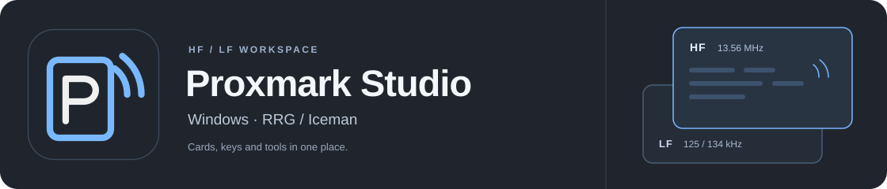
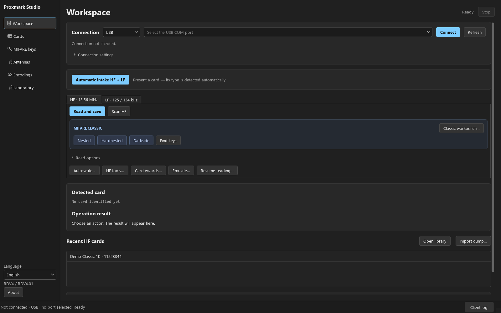

# Proxmark Studio

[English](README.en.md) · [Руководство пользователя](docs/USER_GUIDE_RU.md) · [Выпуски](https://github.com/Semy0nBu/proxmark-studio/releases)

Рабочая область для Proxmark3: найти карту, сохранить чтение, посмотреть данные
и подготовить запись. Карты, ключи и версии дампов собраны в локальной
библиотеке, а инструменты RRG/Iceman доступны из одного интерфейса.

**Русский / English · Windows 10 (1903+) / 11 · x64**

## Скачать

Текущий выпуск — **0.3.0-preview.1**. Python и отдельная установка клиента
Proxmark не нужны: согласованный комплект уже внутри.

| Вариант | Как запустить |
|---|---|
| **[Установщик для Windows](https://github.com/Semy0nBu/proxmark-studio/releases/download/v0.3.0-preview.1/ProxmarkStudio-0.3.0-preview.1-Setup-x64.exe)** | Установить для текущего пользователя. Ярлыки на рабочем столе и в «Пуск» создаются по умолчанию. |
| [Portable ZIP](https://github.com/Semy0nBu/proxmark-studio/releases/download/v0.3.0-preview.1/ProxmarkStudio-0.3.0-preview.1-windows-x64.zip) | Распаковать архив целиком и открыть `ProxmarkStudio.exe`. |

Установка работает без интернета и прав администратора. Подключите Proxmark
по USB, выберите **USB → COM-порт → Подключить**, затем положите карту на
соответствующую HF- или LF-антенну. Дальнейшие шаги — в
[руководстве](docs/USER_GUIDE_RU.md).

## Интерфейс



*На скриншоте — демонстрационные данные. Язык выбирается в боковой панели.*

## Что умеет

| Раздел | Возможности |
|---|---|
| **Чтение HF / LF** | Поиск и определение карт, отдельные диапазоны, автоматический приём с подавлением повторов. |
| **Библиотека карт** | Названия, заметки, поиск, история версий, полные и неполные дампы; продолжение чтения Classic. |
| **Ключи MIFARE** | Кандидаты и подтверждённые значения, источники и даты, словари, импорт файлов Flipper Zero и поддерживаемых данных по USB. |
| **Редактор данных** | HEX, кодировки, печатные строки, карта памяти Classic и условия доступа. |
| **Запись** | Мастер одной HF-карты: проверка цели, резервная копия, просмотр плана и проверка чтением; профильные инструменты LF. |
| **Лаборатория** | Classic / Magic, NDEF, эмуляция, трассы, сигнал / FFT, SPIFFS и измерения HF/LF-антенн с эталоном. |

У неполного дампа есть **карта известных байтов**: пропуски можно заполнить
нулями, сохранив отметку, что эти данные ещё не прочитаны. Мастер записи
показывает план перед изменением карты и проверяет записанные данные чтением.
Запись EM410x в библиотеке хранит идентификатор, а не образ всей памяти чипа.

## Подключение и оборудование

Рабочий стенд проекта — **Proxmark3 RDV4.01 с Blue Shark**.

| Подключение | Что требуется |
|---|---|
| **USB** | Кабель и COM-порт Proxmark в Windows. |
| **Blue Shark** | Bluetooth **Classic SPP**: сопрячь модуль в Windows и выбрать его COM-порт. |
| **TCP** | Отдельный совместимый сетевой мост и адрес `tcp:host:port`. Сервер-мост в приложении не запускается. |

В комплекте есть профили прошивки RDV4 с Blue Shark и без него. Прошивка —
отдельная операция с просмотром плана и резервной копией; установка приложения
её не запускает. Дополнительным Python-скриптам клиента могут понадобиться
внешние пакеты или инструменты.

## Данные и статус выпуска

Библиотека, ключи, настройки и резервные копии находятся в
`%LOCALAPPDATA%\Proxmark Studio`. Папка доступна через **О программе** и
сохраняется при обновлении и удалении приложения. Установщик размещает саму
программу отдельно — в `%LOCALAPPDATA%\Programs\Proxmark Studio`.
Portable-вариант использует ту же пользовательскую библиотеку.

Это **preview-выпуск без цифровой подписи**. На стенде RDV4.01 / Blue Shark
проверялись соединение, чтение Classic и идентификатора EM410x, запись и
восстановление тестовой Classic, передача больших буферов и отмена операций.
Наличие команды в каталоге не означает, что все семейства карт прошли
физические испытания. Скачиваемый комплект содержит только программу и
публичные ресурсы; личные карты и ключи в него не включены.

## Для разработки

Для запуска исходников нужен Python 3.12+ на Windows:

```powershell
.\start.ps1
.\.venv\Scripts\python.exe -m unittest discover -s tests -v
```

Рабочая библиотека исходного проекта хранится отдельно, в `data/personal`.

[Сборка программы и установщика](docs/BUILDING.md) · [Подготовка выпуска](docs/RELEASING.md) · [История изменений](CHANGELOG.md)

## Лицензия и благодарности

Proxmark Studio — **GPL-3.0-or-later**, см. [LICENSE](LICENSE).
Клиент, прошивки и публичные ресурсы Proxmark основаны на работе
[RRG/Iceman](https://github.com/RfidResearchGroup/proxmark3). Их авторство и
лицензии сохранены. Уведомления и соответствующие исходники компонентов входят
в полный комплект — см. [THIRD_PARTY_NOTICES.md](THIRD_PARTY_NOTICES.md).
