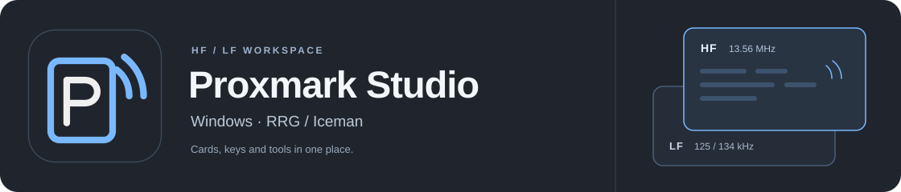
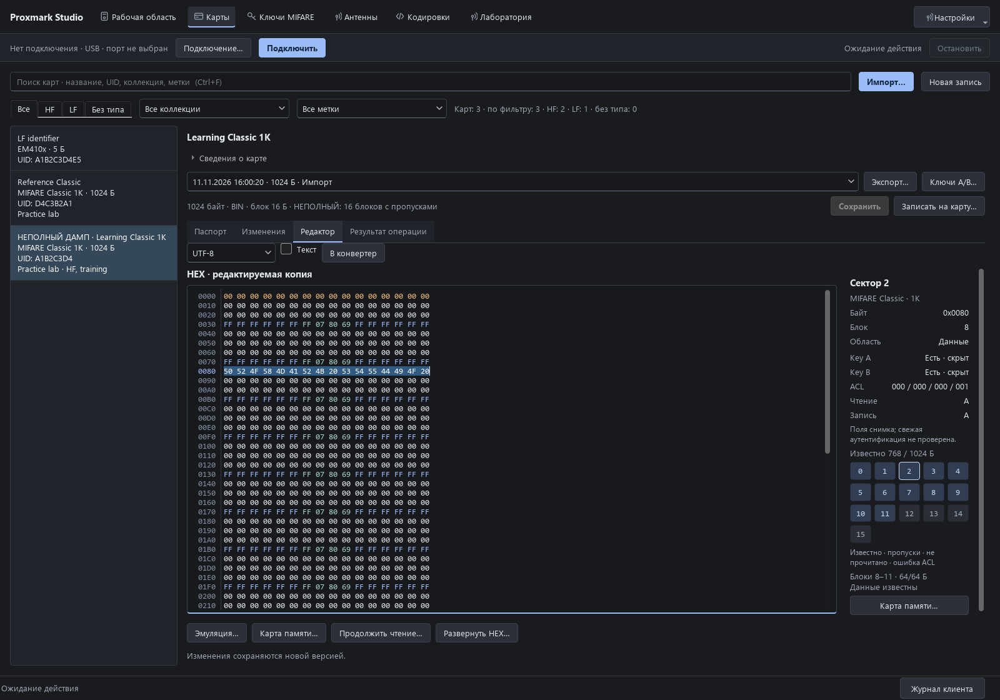

# Proxmark Studio

[English](README.md) · [Руководство пользователя](docs/USER_GUIDE_RU.md) · [Выпуски](https://github.com/Semy0nBu/proxmark-studio/releases)

Рабочая область для Proxmark3: найти карту, сохранить чтение, посмотреть данные
и подготовить запись. Карты, ключи и версии дампов собраны в локальной
библиотеке, а инструменты RRG/Iceman доступны из одного интерфейса.

**Русский / English · Windows 10 (1903+) / 11 · x64**

## Скачать

Текущий предварительный выпуск — **0.3.0-preview.10**. Python и отдельная установка клиента
Proxmark не нужны: согласованный комплект уже внутри.

| Вариант | Как запустить |
|---|---|
| **[Установщик для Windows](https://github.com/Semy0nBu/proxmark-studio/releases/download/v0.3.0-preview.10/ProxmarkStudio-0.3.0-preview.10-Setup-x64.exe)** | Установить для текущего пользователя. Ярлыки на рабочем столе и в «Пуск» создаются по умолчанию. |
| [Portable ZIP](https://github.com/Semy0nBu/proxmark-studio/releases/download/v0.3.0-preview.10/ProxmarkStudio-0.3.0-preview.10-windows-x64.zip) | Распаковать архив целиком и открыть `ProxmarkStudio.exe`. |

Установка работает без интернета и прав администратора. Подключите Proxmark
по USB, выберите **USB → COM-порт → Подключить**, затем положите карту на
соответствующую HF- или LF-антенну. Дальнейшие шаги — в
[руководстве](docs/USER_GUIDE_RU.md).

## Интерфейс



*Workbench с демонстрационными данными: рабочий HEX, карта секторов и инспектор прав доступа. Язык, режим интерфейса и резервное копирование — в «Настройках».*

## Что умеет

| Раздел | Возможности |
|---|---|
| **Чтение HF / LF** | Поиск и определение карт, отдельные диапазоны, автоматический приём с подавлением повторов. |
| **Библиотека карт** | Коллекции и метки, история версий, заполненность памяти и пропуски, продолжение чтения Classic. |
| **Ключи MIFARE** | Кандидаты и подтверждённые значения, источники и даты, словари, импорт файлов Flipper Zero и поддерживаемых данных по USB. |
| **Редактор данных** | Развёрнутый HEX, кодировки и сравнение версий: новые данные, изменённые значения и потеря сведений. |
| **Запись** | Источник и заготовка рядом, совместимость и причины ограничений, резервная копия, подтверждение плана и проверка чтением. Общий вид для существующих мастеров HF и LF. |
| **Режимы интерфейса** | «Пошаговый» показывает пояснения, «Компактный» раскрывает их по запросу. Проверки записи одинаковы. |
| **Резервная копия** | Весь профиль в один архив, пароль по желанию и восстановление в отдельный профиль. |
| **Лаборатория** | Classic / Magic, NDEF, эмуляция, трассы, сигнал / FFT, SPIFFS и измерения HF/LF-антенн с эталоном. |
| **Опытный режим** | Именованные сценарии с просмотром команд, каталог конкретного клиента и обезличенный диагностический архив. |

У неполного дампа есть **карта известных байтов**: пропуски можно заполнить
нулями, сохранив отметку, что эти данные ещё не прочитаны. Мастер записи
показывает план перед изменением карты и проверяет записанные данные чтением.
Запись EM410x в библиотеке хранит идентификатор, а не образ всей памяти чипа.

Паспорт показывает известные данные выбранной версии. При сравнении Classic
отдельно видны данные, ключи, права доступа и блок 0. Неизвестные A/B не попадают
в план смены ключей. После прерванной HF-записи можно перечитать карту, сравнить
результат и подготовить новый план с отдельным подтверждением.
Коллекции, избранное, каталог и большое окно HEX описаны в
[руководстве по библиотеке и инструментам](docs/DESKTOP_WORKFLOWS.md#по-русски).

## Подключение и оборудование

Рабочий стенд проекта — **Proxmark3 RDV4.01 с Blue Shark**.

| Подключение | Что требуется |
|---|---|
| **USB** | Кабель и COM-порт Proxmark в Windows. |
| **Blue Shark** | Bluetooth **Classic SPP**: сопрячь модуль в Windows и выбрать его COM-порт. |
| **TCP** | Отдельный совместимый сетевой мост и адрес `tcp:host:port`. Сервер-мост в приложении не запускается. |

В preview.10 кнопка **Connect** с комплектным клиентом открывает прямое
Bluetooth-соединение, обходя виртуальный COM-порт Windows. Для него оставьте
**Keep connection** включённым; COM-порт выбирается как прежде.

При включённом **«Держать соединение»** после обрыва в простое выполняется
ограниченная проверка версии. Операции с картами автоматически не повторяются.
Stop дожидается завершения клиента и проверяет плату; неудачная проверка не
блокирует выход из GUI, когда клиент уже остановлен.

В комплекте есть профили прошивки RDV4 с Blue Shark и без него. Прошивка —
отдельная операция с просмотром плана и резервной копией; установка приложения
её не запускает. Дополнительным Python-скриптам клиента могут понадобиться
внешние пакеты или инструменты.

## Данные и статус выпуска

Библиотека, ключи, настройки и резервные копии находятся в
`%LOCALAPPDATA%\Proxmark Studio`. Папка доступна через **О программе** и
сохраняется при обновлении и удалении приложения. Установщик размещает саму
программу отдельно — в `%LOCALAPPDATA%\Programs\Proxmark Studio`.
Portable-вариант использует ту же пользовательскую библиотеку. Для обновления
с `preview.1` закройте GUI и клиент Proxmark, затем запустите новый установщик
поверх существующей установки. Перед обновлением сохраните отдельную копию
папки данных. Переход на более старую версию не поддерживается.

**Библиотека не зашифрована.** История команд и журналы могут содержать ключи и
пароли. В GUI нет автоматической отправки библиотеки; отдельные сценарии клиента
могут обращаться к внешним сервисам. Подробнее — [данные и приватность](docs/PRIVACY_RU.md).

Это **preview-выпуск без цифровой подписи**. На стенде RDV4.01 / Blue Shark
проверялись соединение, чтение Classic и идентификатора EM410x, запись и
восстановление тестовой Classic, передача больших буферов и отмена операций.
Наличие команды в каталоге не означает, что все семейства карт прошли
физические испытания. Скачиваемый комплект содержит только программу и
публичные ресурсы; личные карты и ключи в него не включены.

## Для разработки

Для запуска исходников нужен Python 3.12+ на Windows:

```powershell
.\start.ps1
.\.venv\Scripts\python.exe -m unittest discover -s tests -v
```

Рабочая библиотека исходного проекта хранится отдельно, в `data/personal`.

[Сборка программы и установщика](docs/BUILDING.md) · [Подготовка выпуска](docs/RELEASING.md) · [История изменений](CHANGELOG.md)

## Лицензия и благодарности

Proxmark Studio — **GPL-3.0-or-later**, см. [LICENSE](LICENSE).
Клиент, прошивки и публичные ресурсы Proxmark основаны на работе
[RRG/Iceman](https://github.com/RfidResearchGroup/proxmark3). Их авторство и
лицензии сохранены. Уведомления и соответствующие исходники компонентов входят
в полный комплект — см. [THIRD_PARTY_NOTICES.md](THIRD_PARTY_NOTICES.md).

**Библиотека…** — резервная копия карт, всех версий,
ключей и настроек в один архив, пароль по желанию и восстановление в отдельный
профиль. [Как пользоваться](docs/LIBRARY_BACKUPS.md#по-русски).
