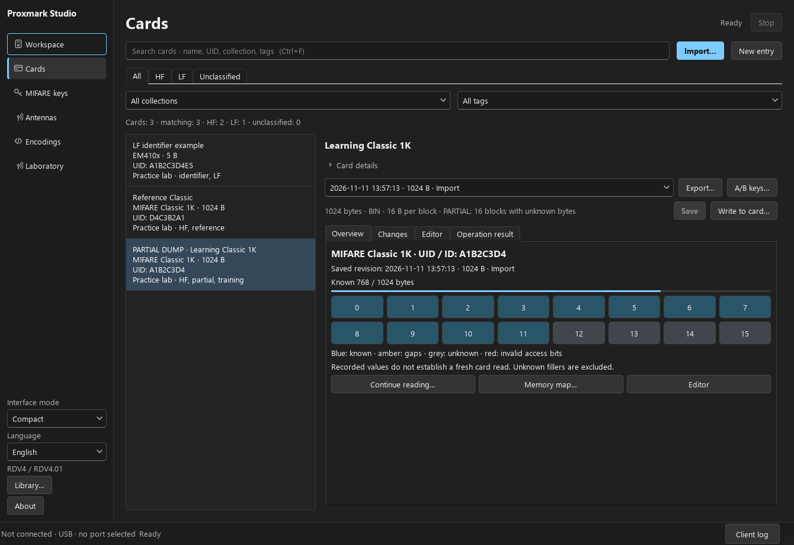
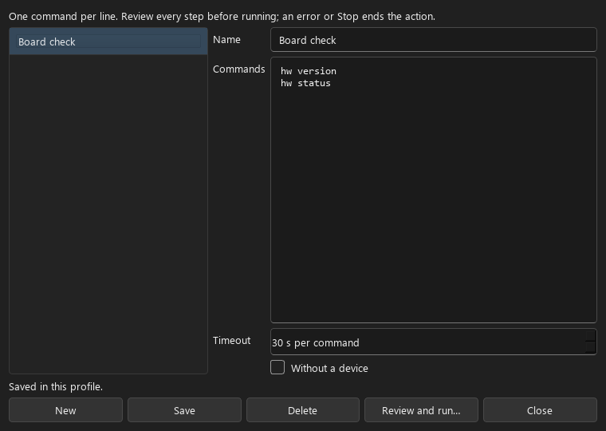
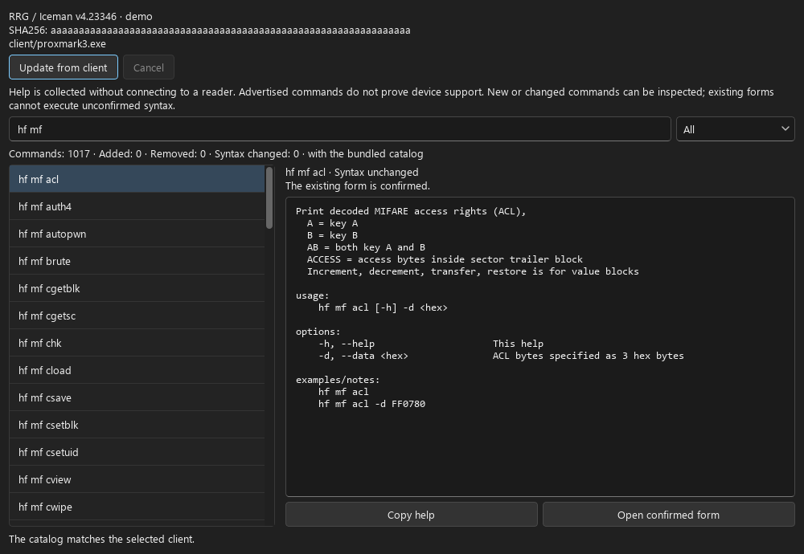
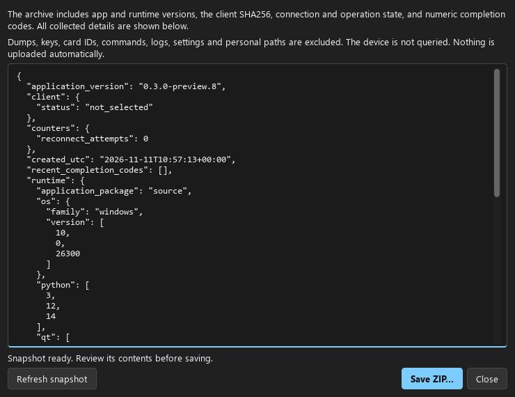

# Library and expert workflows

These tools work with the current profile. Browsing, organizing a library,
editing an action and preparing a diagnostic report do not query a card.

## Collections and tags

Open **Cards → Card details**, choose or type a **Collection**, and enter
comma-separated **Tags**. Save the record. Collection and tag filters combine
with search and the HF/LF tabs. Names are compared without case differences,
including non-English names.

Grouping belongs to a library record, not its UID. Two records with the same
UID can belong to different collections. Changing these fields does not alter
the selected dump, create a dump revision or switch an older selected revision
to the latest one. Existing libraries acquire the additional tables on opening.
Whole-profile backup and restore include the grouping information.

## Quick actions

Open **Laboratory → Console → Quick actions…**. Give an action a name and enter
one client command per line, up to 20 steps. Set the timeout per command and,
for host-only tools, choose **Without a device**. Save it in the current profile.
An action can also be started without saving.

**Review and run…** shows all steps before starting. Commands use the existing
single-client queue; other device operations cannot replace a running action.
An error or Stop ends the sequence. A failed command is never automatically
replayed. RF actions use the existing field cleanup and fresh connection check.

This is the expert console: a command can modify a card or board. A successful
client exit is reported as client output, not as verified card readback. Use the
source-to-blank writer when a prepared backup and readback plan are needed.

`quick-actions.json` is local profile data and is included in library backups.
Saved arguments can contain private values, just like console history. Loading
or selecting an action never runs it. Unsupported saved commands remain editable
after an update and are rejected before execution.

## Selected client catalog

Open **Laboratory → Console → Selected client catalog…**, then **Update from
client**. A separate cancellable task obtains the selected binary's offline
help and version. It does not pass a port or send reader commands. A client
without a complete offline help export leaves the previous catalog intact.

The snapshot is bound to the executable's path and SHA256. The inspector shows
added, removed and changed command syntax against the previous snapshot, or the
bundled catalog on the first update. Descriptions alone do not count as syntax
changes. Search and filters make differences available for inspection.

**Open confirmed form** is available when the selected binary and advertised
syntax match the existing form. New or changed syntax is help-only until a form
is adapted. Replacing or editing the selected binary makes the cached snapshot
stale; update it before running catalog-bound expert commands. Normal native
card workflows do not require a manual catalog update.

Advertised help establishes command syntax. It does not establish firmware,
hardware, card-family support or a successful physical test. The cache stays in
`client-catalog.json` in the current profile.

## Diagnostic package

Open **Laboratory → Diagnostics → Diagnostic report…**. Review the displayed
JSON, then choose **Save ZIP…** outside the active profile. The archive contains:

- application, Python, Qt and numeric operating-system versions;
- client binary SHA256 when readable;
- normalized transport, operation and connection states;
- a bounded reconnection counter and recent numeric completion codes;
- a scope description and file-integrity manifest.

Raw logs, command arguments, dumps, keys, card/device identifiers, addresses,
profile names, settings and personal paths are excluded. The report does not
contact a device or upload anything. `unknown` and `null` explicitly indicate
unavailable information. The report describes the captured moment, not a full
operation history. Share the ZIP with a description of the problem if desired.

## Larger HEX editor

In **Cards**, open the **Dump** tab and choose **Expand HEX…**. The resizable
window shows the same working document as the main editor. Edits appear in
both views, use the same undo history and remain unsaved until the card record
is saved. Opening or closing this window does not create a revision or write a
physical card. Changing the selected library snapshot updates both views.

All screenshots use synthetic data. They demonstrate controls, not RF results.
Physical coverage and troubleshooting are documented in the
[user guide](USER_GUIDE_EN.md#recorded-hardware-coverage).

## По-русски

В **Карты → Сведения о карте** задайте коллекцию и метки через запятую, затем
сохраните. Фильтры коллекции и метки работают вместе с поиском и HF/LF.
Группировка относится к записи библиотеки, не меняет дамп и выбранную старую
версию. Она переносится вместе с резервной копией профиля.

**Лаборатория → Консоль → Избранные действия…**: название, до 20 команд по одной
в строке и лимит на каждую. Перед выполнением просматривается весь сценарий.
Ошибка или Stop прекращают очередь; повторной отправки нет. Это опытный режим
консоли, а не замена мастера записи с резервной копией и проверкой чтением.

**Каталог выбранного клиента… → Обновить из клиента** получает полную справку
без подключения к плате. Каталог связан с конкретным EXE и его SHA256. Видны
добавленные, исчезнувшие и изменённые команды. Новые и изменённые команды
пока доступны для просмотра; старая форма с другим синтаксисом не запускается.
После замены EXE обновите каталог. Основные мастера не требуют этой процедуры.

**Лаборатория → Диагностика → Отчёт для диагностики…** показывает точный JSON
перед сохранением ZIP. В нём только версии, SHA256 клиента, нормализованные
состояния и числовые коды. Журналы, команды, UID, ключи, дампы, настройки,
имена профилей и личные пути не включаются. Отчёт не отправляется автоматически.
Архив сохраняется вне активного профиля.

**Карты → Дамп → Развернуть HEX…** открывает большое окно той же рабочей копии.
Правки видны в обоих редакторах и сохраняются только обычной кнопкой сохранения
записи. Само окно не создаёт версий и не записывает физическую карту.

Все иллюстрации синтетические. Проверенные носители, границы аппаратных тестов
и причины ошибок приведены в [русском руководстве](USER_GUIDE_RU.md).
